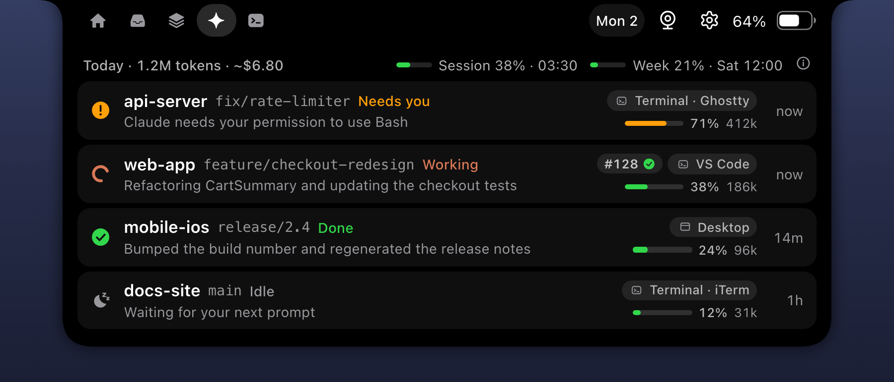

<h1 align="center">
  <picture>
    <source media="(prefers-color-scheme: dark)" srcset="docs/branding/nubrix-logo-dark.svg">
    
  </picture>
</h1>

Nubrix is a notch bar for macOS built for developers. It is based on [boring.notch](https://github.com/TheBoredTeam/boring.notch), so you get music controls, volume and brightness HUDs and a file shelf, and it adds:

- **Claude Code in the notch:** live status of every session, plan usage, and permission requests you can approve from the notch
- **Vitrin:** a clipboard and screenshot showcase that never stores text that looks like a secret
- **Developer tools:** `notchctl` banners from any script, a localhost port watcher, and read-only GitHub PR and CI status
- **Notifications from other apps** (optional): new WhatsApp, Slack or Mail notifications as a banner in the notch, and a Notifications tab to look back at them

Everything runs locally. There is no account, no cloud service, no telemetry and no auto-updater. The few optional network uses are listed under [Privacy and security](#privacy-and-security).

[](LICENSE)
[](#requirements)
[](https://github.com/murathanbakti/nubrix/releases/latest)

<p align="center">
  
  <br>
  <sub>All images are rendered mockups with sample data. See <a href="docs/images/README.md">docs/images</a>.</sub>
</p>

Contents: [Quick start](#quick-start) · [Features](#features) · [Install](#install) · [First launch](#first-launch-and-gatekeeper) · [Permissions](#permissions) · [Claude Code setup](#claude-code-setup) · [GitHub](#github-integration) · [notchctl](#notchctl) · [Settings](#settings) · [Privacy and security](#privacy-and-security) · [Troubleshooting](#troubleshooting) · [Updating](#updating) · [Uninstall](#uninstall) · [Contributing](#building-and-contributing) · [License and credits](#license)

## Quick start

1. Install and open Nubrix (macOS 14 or later):
   ```sh
   brew tap murathanbakti/tap
   brew trust --tap murathanbakti/tap
   brew install --cask nubrix
   open -a Nubrix
   ```
   The first launch walks you through the optional permissions. Everything can be skipped and turned on later in Settings.
2. For Claude Code session status, install the hook scripts. The installer prints a snippet; merge it into `~/.claude/settings.json` yourself (it never edits that file):
   ```sh
   bash /Applications/Nubrix.app/Contents/Resources/nubrix-hooks/scripts/install-hooks.sh
   ```
3. Start a new Claude Code session. It appears in the notch's "Claude" tab.
4. Optional: to see WhatsApp, Slack or Mail notifications in the notch, turn on Settings, Notifications, Other apps. Nubrix opens the right page in System Settings and shows you what to drag where.

Other install methods are under [Install](#install); the hook setup is explained step by step under [Claude Code setup](#claude-code-setup).

## Features

**Claude Code sessions** (notch tab "Claude")
- Shows each Claude Code session as Working, Needs you, Failed, Done or Idle, fed by Claude Code hooks
- Works with the Claude Code CLI, the desktop app and the VS Code extension; each row shows where the session runs (Desktop, Terminal · iTerm, VS Code, Cursor, ...) and its git branch. Clicking a row, or a Claude banner on the closed notch, opens that session: a desktop app session opens directly in Claude, a Terminal or iTerm session brings its own tab to the front, and other apps are brought to the front
- Context window bar and token count per row (cost in the row tooltip and the header's Today line), and your 5-hour and weekly plan usage as percentages ([details](#usage-context-and-cost))
- Approve or deny Claude Code permission requests from the notch (Allow needs a real mouse click and risky requests need a second click; see [Approving permissions from the notch](#approving-permissions-from-the-notch))
- A done, failed or needs-you event shows a banner on the closed notch and an inbox entry

<p align="center">
  
</p>
<p align="center">
  
</p>

**Vitrin, a clipboard and screenshot showcase** (notch tab "Vitrin", global shortcut Control-Option-V)
- Keeps copied images, text and links locally and shows them as cards, with a filter for All, Images, Screenshots, Text and Links
- Screenshots: after you allow read-only access to the folder where macOS saves screenshots, new screenshots appear in Vitrin and a thumbnail banner shows in the closed notch. Nubrix never changes files there
- Showcase panel under the notch with search and keyboard navigation (arrows, Enter to copy, P to pin (⌘P in the large preview), Delete to remove, Space for a large preview, Esc to close)
- Secret guard: text that looks like a credential (private keys, `sk-` keys, GitHub tokens, AWS keys, Slack tokens, JWTs, `Bearer` tokens, long high-entropy strings) is never stored; concealed, transient and password-manager pasteboard types are skipped
- Excluded apps: nothing copied while an excluded app is frontmost is stored (password managers and Keychain Access are excluded by default; the list is editable)
- Retention: history expires after a configurable period (default 30 days); pinned items never expire
- Per-type capture toggles for images, text, links and screenshots

<p align="center">
  
</p>

**Developer insights** (inside Vitrin)
- Detects JSON, code language (Swift, TypeScript/JavaScript, Python, Go, Rust, SQL, Shell, YAML, HTML, CSS), Base64, percent-encoded text, Unix timestamps, colors and UUIDs
- Cards show a badge and a lightweight syntax-highlighted preview
- Actions: copy pretty or minified JSON, copy decoded Base64 or URL text, copy ISO date, copy hex or rgb

<p align="center">
  
</p>

**Dev tab, GitHub and notchctl**
- `notchctl` is a bash and curl CLI that shows a banner in the closed notch, for example `gh run watch && notchctl notify "CI green"`
- The "Dev" tab keeps the last notifications and shows which localhost ports (3000, 5173, 8080, 5432 and others, configurable) are listening; clicking an HTTP port opens it in the browser
- The Dev tab has a GitHub, Servers and Notifications switch. GitHub shows three columns: PRs where your review is requested, your open PRs (CI checks, review decision, merge conflicts, draft) and recent GitHub Actions runs of your watched repositories
- A closed-notch banner and a notification entry appear for a new review request, your PR's CI turning red or green, a merge conflict, and a failed workflow run on a default branch, on your PR branches, on your Claude session branches or started by you
- Each Claude session row shows the PR of its branch as a small chip (`#123` with a CI mark); click it to open the PR
- Read-only: Nubrix never writes to GitHub. See [GitHub integration](#github-integration)

<p align="center">
  
</p>
<p align="center">
  
</p>
<p align="center">
  
</p>

**Music, HUDs and shelf**
- Live music activity with playback controls and a visualizer. Sources: system Now Playing, Apple Music, Spotify and YouTube Music. Optional synced lyrics (off by default)
- Custom volume, display brightness and keyboard brightness HUDs in the notch (optional; needs Accessibility, see [Permissions](#permissions))
- File shelf with drag and drop and quick share

<p align="center">
  
</p>
<p align="center">
  
</p>

**Calendar, meetings and mirror**
- Calendar sheet that drops from the notch (header date pill or Control-Option-K) for your events, with a day panel and quick add
- Meeting countdown in the closed notch, and a meeting card with a Join button on the Home tab when the event has a Zoom, Google Meet, Teams, Webex, Whereby or Slack Huddle link
- Mirror: a camera preview that splits out of the notch (Control-Option-M)

<p align="center">
  
</p>

**Notifications from other apps** (optional, off by default)
- New notifications from the apps you pick (for example WhatsApp, Slack or Mail) appear as a banner on the closed notch with the app icon, sender and message; it disappears after 6 seconds, and clicking it opens the app
- Needs Full Disk Access, because macOS has no public way to read other apps' notifications. When you turn it on, a small guide opens next to System Settings: drag the Nubrix icon into the list, turn on its switch, and the guide confirms as soon as access works
- The Notifications tab (bell icon, shown while the feature is on) lists the last 50 notifications, newest first, with a filter per app. Click a row to open its app, hover to remove one, or Clear them all. New ones put a dot on the tab
- Quick reply: hover a row and click the reply arrow, type, press Return. Nubrix fills in the reply box of that same notification in macOS Notification Center and sends it, so it works for apps whose notifications have a Reply button (WhatsApp, Messages, Slack and others). If the notification is no longer in Notification Center, Nubrix briefly opens Notification Center to find it. It sends only when it finds exactly that one notification (same sender and message) and the text reads back unchanged; otherwise it sends nothing, copies your text and opens the app so you can paste it. Needs Accessibility for `NubrixHelper`; if it is missing, the first reply opens a short guide next to System Settings and continues as soon as access works. Turn it off in Settings, Notifications, Other apps. This drives the macOS interface, so a macOS update can break it; the copy-and-open fallback still works then
- Only the apps you tick are read. The list is kept in memory only and is gone when Nubrix quits. Notifications from the app you are using are skipped, and the message text can be hidden
- Tip: set an app's alert style to None in System Settings, Notifications to see its notifications only in the notch

<p align="center">
  
</p>

## Requirements

- macOS 14 Sonoma or later, Apple silicon or Intel
- Building from source needs Xcode 26 or later

Nubrix works on Macs with and without a notch. Without a notch it draws the bar at the top centre of the display; the height is set in Settings, General ("Notch height on non-notch displays"). "Show on all displays" is off by default.

## Install

Each release on [GitHub Releases](https://github.com/murathanbakti/nubrix/releases) has a `Nubrix-<version>.zip` (a universal arm64 and x86_64 `Nubrix.app`) and a `.sha256` checksum, both built by GitHub Actions. From 0.1.1 on, releases are signed with a Developer ID and notarized by Apple, so macOS opens them without a Gatekeeper prompt however you install. 0.1.0 was ad-hoc signed; each release's notes say which kind it is.

### Homebrew (recommended)

```sh
brew tap murathanbakti/tap
brew trust --tap murathanbakti/tap
brew install --cask nubrix
```

`brew trust` is needed because Homebrew 7 only installs from third-party taps you have trusted.

The cask pins the release's SHA-256 and leaves the quarantine flag in place, so Gatekeeper checks the Developer ID signature and Apple's notarization ticket on first launch, as for any other app.

### Install script

```sh
curl -fsSL https://raw.githubusercontent.com/murathanbakti/nubrix/main/scripts/install.sh | bash
```

The script downloads the latest release zip and its `.sha256`, verifies the checksum, the bundle identifier and the code signature, and installs `Nubrix.app` to `/Applications`. Options: `NUBRIX_VERSION` (a specific version), `NUBRIX_INSTALL_DIR` (default `/Applications`) and `NUBRIX_SHA256` (a checksum you copied from the release page, checked as well).

Files downloaded with `curl` carry no quarantine flag, so there is no Gatekeeper prompt; trust rests on HTTPS to GitHub, the checksum and the signature check, and the script tells you whether the version it installed is notarized. Piping a script into a shell runs whatever the server sends, so read it first if you can:

```sh
curl -fsSLO https://raw.githubusercontent.com/murathanbakti/nubrix/main/scripts/install.sh
less install.sh
bash install.sh
```

### From source

```sh
git clone https://github.com/murathanbakti/nubrix.git
cd nubrix
scripts/install-local.sh --open
```

This needs Xcode 26 or later. The script builds Release into `~/Library/Caches/Nubrix/DerivedData`, verifies the bundle (hardened runtime on, no `get-task-allow`, only the expected helper and frameworks), quits a running Nubrix, installs `Nubrix.app` to `/Applications`, runs `scripts/install-hooks.sh` and, with `--open`, starts the app. It stops if a check fails. A build you made yourself opens with no Gatekeeper prompt.

If your Mac has an Apple Development or Developer ID Application certificate (any free Apple account signed in to Xcode creates one), the script signs the app with it, so macOS keeps Keychain access and permissions across rebuilds. The first time, macOS may ask to let `codesign` use the key; choose Always Allow. Without a certificate the app is signed ad hoc. Set `NUBRIX_SIGN_IDENTITY` to a certificate name or SHA-1 to choose one, or to `-` to force ad-hoc signing. The certificate stays in your Keychain; nothing about it is written to the repository.

## First launch and Gatekeeper

Releases from 0.1.1 on are notarized and open normally. This section is only for a zip of 0.1.0, or another release that is not notarized, downloaded with a browser:

1. Open Nubrix (Spotlight or `/Applications`). macOS says "Nubrix" was blocked or cannot be verified. Click **Done** (**Cancel** on macOS 14 Sonoma). Do **not** click **Move to Trash**: that deletes the app.
2. Open Privacy & Security:
   ```sh
   open "x-apple.systempreferences:com.apple.settings.PrivacySecurity.extension"
   ```
   or go to System Settings, Privacy & Security, and scroll down to "Nubrix was blocked to protect your Mac".
3. Click "Open Anyway" and confirm with your admin password or Touch ID. Open Nubrix again and confirm.

You do this once per download. On macOS 14 Sonoma you can instead right-click Nubrix in Finder, choose Open and confirm; on macOS 15 Sequoia and later only Privacy & Security works. Do not turn Gatekeeper off (`spctl --master-disable`): it protects every other app on your Mac.

If you verified the download's origin and checksum yourself, `xattr -d com.apple.quarantine /Applications/Nubrix.app` removes the quarantine flag for that one app.

## Permissions

Nubrix asks for access only when you use the feature that needs it (the onboarding screen also offers the ones marked with an asterisk):

| Permission | Why | When |
|---|---|---|
| Calendars (full access)* | Show upcoming events, meeting countdown, add events from the calendar sheet. Nubrix does not ask for Reminders access | Calendar and meeting features |
| Camera* | Mirror preview | When you open Mirror |
| Accessibility* | Intercept volume and brightness keys to replace the system HUDs, and type quick replies into a notification's Reply box in Notification Center. Granted to the helper process `NubrixHelper`, which is not sandboxed | Only if you turn on "Replace system HUD" or send a quick reply |
| Automation (Apple Events) | Control Spotify and Apple Music, and find the tab of a Claude session in Terminal or iTerm. These four are the only apps Nubrix is allowed to script | When you pick those sources in Settings, Media, or first click a Terminal or iTerm session |
| Screenshot folder | A folder picker; Nubrix keeps read-only access to the folder you choose | When you enable screenshots in Vitrin |
| Pasteboard access | On recent macOS versions macOS may ask whether Nubrix may read what other apps copy. Vitrin cannot capture anything while access is denied | When Vitrin starts capturing |
| Keychain | Stores the optional GitHub token | When you save a token |
| Full Disk Access* | Read the macOS notification database to show other apps' notifications. Granted to Nubrix; the reading is done by the unsandboxed helper `NubrixHelper`, which only opens that one database, read-only. Nubrix shows a guide for granting it | Only if you turn on Settings, Notifications, Other apps |

Nubrix's own banners are drawn in the notch; it does not post to the macOS notification centre. Full Disk Access is only needed for notifications from other apps; everything else works without it. There is no Screen Recording permission.

## Claude Code setup

Nubrix listens on a loopback HTTP server, and small hook scripts forward Claude Code hook events to it. The event hooks are asynchronous, have a short timeout and always exit 0, so they never block or slow down Claude Code. `nubrix-permission` is the one synchronous hook: it waits for your answer on the approval card (12 seconds in a terminal, 110 seconds for the Claude desktop app, the VS Code extension and SDK sessions) and then falls back to Claude Code's own permission dialog. If Nubrix is not running, the hooks do nothing.

**1. Install the hook scripts.**

- Homebrew or install script:
  ```sh
  bash /Applications/Nubrix.app/Contents/Resources/nubrix-hooks/scripts/install-hooks.sh
  ```
  Run it through `bash` (adjust the path if you used `NUBRIX_INSTALL_DIR`): macOS can refuse to execute files inside an app downloaded with a browser. Run from the app bundle, it first verifies the app's code signature.
- From source: `scripts/install-hooks.sh` (already run by `scripts/install-local.sh`).

The installer copies `nubrix-hook`, `nubrix-permission`, `nubrix-statusline` and `notchctl` to `~/.config/nubrix/bin/` as read-only files, outside any repository, so neither Claude nor a `git pull` can change what your hooks run ([why](docs/nubrix/CLAUDE-CODE.md#why-sealed-copies)). Re-run it after every Nubrix update.

**2. Merge the printed snippet into `~/.claude/settings.json`.** The installer never edits that file. The snippet has the exact paths for your machine; shortened, it looks like this, with the same hook block repeated for SessionStart, UserPromptSubmit, PreToolUse, PostToolUse, PostToolUseFailure, PermissionRequest, PermissionDenied, Notification, Stop, StopFailure and SessionEnd:

```json
{
  "hooks": {
    "SessionStart": [
      { "hooks": [ { "type": "command", "command": "~/.config/nubrix/bin/nubrix-hook", "async": true, "timeout": 5 } ] }
    ],
    "Stop": [
      { "hooks": [ { "type": "command", "command": "~/.config/nubrix/bin/nubrix-hook", "async": true, "timeout": 5 } ] }
    ]
  },
  "statusLine": { "type": "command", "command": "~/.config/nubrix/bin/nubrix-statusline" },
  "permissions": {
    "deny": [
      "Edit(~/.config/nubrix/**)", "Write(~/.config/nubrix/**)",
      "Edit(~/.config/nubrix-run/**)", "Write(~/.config/nubrix-run/**)",
      "Read(~/.config/nubrix-run/**)"
    ]
  }
}
```

- `permissions.deny` keeps Claude from editing the scripts or reading Nubrix's local token; it is merged with your existing list.
- If you already use a status line, call `nubrix-statusline` from it, or pipe its input to both.
- The `PermissionRequest` block also contains the `nubrix-permission` hook for [notch approvals](#approving-permissions-from-the-notch). Drop it to keep Claude Code's own permission dialogs only.

**3. Check the connection.** Start a new Claude Code session. The info button in the Claude tab shows "All connected" when hook events arrived in the last 10 minutes and all four scripts are installed; otherwise it lists what is wrong, with a one-line fix.

For a quick look without touching your settings, a status-only [plugin](docs/nubrix/CLAUDE-CODE.md#plugin-status-only-source-checkout) can be loaded from a source checkout.

### Usage, context and cost

- **Context and tokens** come from the tail of the session transcript, read by the hook when a turn ends. Only numbers are sent to Nubrix, never message text. In a terminal, the status line adds exact context and cost.
- **Plan usage** (the 5-hour session and weekly percentages) comes from `claude /usage`, which the helper runs in the background. It is a local command, not a model call, so it costs no tokens. The Claude CLI must be signed in (`claude auth login`). Turn it off in Settings, Notifications, Claude Code.
- **Costs** are marked `~` because they are estimates from built-in list prices; plans and discounts are not reflected.
- Alerts appear when a session's context crosses 85% and when plan usage crosses 80% and 95%.

Exact sources, limits, timing and what is stored: [docs/nubrix/CLAUDE-CODE.md](docs/nubrix/CLAUDE-CODE.md#usage-context-and-cost).

### Approving permissions from the notch

With the `nubrix-permission` hook, Claude Code's permission requests also appear in the notch with the full command, file or diff, and Allow and Deny.

- Allow needs a real mouse click after the card has been on screen briefly; risky requests (`rm -rf`, `sudo`, force pushes, writes to sensitive files, hidden characters and more) need a second "Allow anyway" click.
- Claude's own questions and plan approvals are not shown in the notch; answer those in Claude.
- Nothing is approved automatically. If Nubrix is not running, the screen is locked, the toggle is off or no answer arrives in time, Claude Code asks in its own dialog as before.
- The hook only trusts a reply that the running Nubrix proves with an HMAC over a fresh nonce.
- Turn it off in Settings, Notifications, "Approve Claude Code permissions from the notch".

All rules, risk flags and wait times: [docs/nubrix/CLAUDE-CODE.md](docs/nubrix/CLAUDE-CODE.md#approving-permissions-from-the-notch).

## GitHub integration

Nubrix reads GitHub with a **fine-grained, read-only personal access token** for the repositories you choose (Settings, GitHub, "Create token on GitHub"). Give it Read access to Metadata, Pull requests, Actions, Commit statuses and optionally Checks, and nothing else.

- The token is kept only in the macOS Keychain and only sent to `api.github.com`.
- Nubrix never writes to GitHub, and it does not use your `gh` login or SSH keys, which can write.
- It polls every 2 minutes (every 30 seconds while the GitHub section is open), respects rate limits and pauses while the Mac sleeps.

Requests, polling rules and why this kind of token: [docs/nubrix/GITHUB.md](docs/nubrix/GITHUB.md).

## notchctl

The hook installer puts a sealed copy at `~/.config/nubrix/bin/notchctl`:

```sh
~/.config/nubrix/bin/notchctl notify "Build done" --title api --style success
~/.config/nubrix/bin/notchctl ping
```

See [cli/README.md](cli/README.md) for styles, duration, putting it on your `PATH` and more examples.

## Settings

Open Settings from the menu bar icon or, if enabled, the settings icon in the open notch.

| Tab | What it controls |
|---|---|
| General | Menu bar icon, launch at login, displays, notch size and non-notch height, open on hover, gestures, haptics |
| Appearance | Accent colour, settings icon in the notch, spectrogram and album-art options, custom Lottie visualizers, mirror options |
| Media | Music source (Now Playing, Apple Music, Spotify, YouTube Music), lyrics, full screen behavior |
| Calendar | Calendars shown in the notch, on the Home tab and in the calendar sheet |
| HUDs | Replace the system volume, display and keyboard-brightness HUDs (needs Accessibility) |
| Battery | Power and charging notifications in the notch |
| Shelf | File shelf behaviour |
| Vitrin | Capture toggles, screenshot folder and preview, retention, excluded apps, hide from screen sharing, clear history |
| Dev | Which localhost ports are watched |
| GitHub | Token, watched repositories, notification toggles |
| Notifications | Inbox sources (Claude Code, notchctl, GitHub), notifications from other apps, notch approvals, plan usage, Home usage card, meeting countdown |
| Shortcuts | Global keyboard shortcuts (defaults: Control-Option-V Vitrin, Control-Option-K calendar, Control-Option-M mirror) |
| Advanced | Additional options |
| About | Version, credits and licenses |

## Privacy and security

- Everything stays on your Mac. Nubrix has no analytics, no account and sends nothing to a Nubrix server. It has no auto-updater.
- Network use, complete list:
  - `api.github.com`, only if you add a fine-grained read-only token (off until then; see [GitHub integration](#github-integration)). The token goes nowhere else.
  - `lrclib.net` receives the track title and artist when lyrics are turned on (off by default).
  - LottieFiles: a visualizer animation (JSON) is downloaded when the built-in music visualizer is turned off in Settings.
  - Artwork URLs supplied by Spotify or YouTube Music are fetched to show the cover.
  - `localhost:26538`, the local API of the YouTube Music desktop app, when that controller is used.
  - The `claude` command-line tool, run by the helper to read your plan usage (see [Usage, context and cost](#usage-context-and-cost)); Claude itself talks to Anthropic as it always does. Turn it off in Settings, Notifications, Claude Code.
- **Sandbox and helper split.** The app is sandboxed. The only unsandboxed part is the small XPC service `NubrixHelper`, used for Accessibility-based key handling, brightness, the `claude /usage` probe and, when turned on, the read-only reader of the macOS notification database. The app can read `~/.config/nubrix/` (the sealed hook scripts) but cannot write there, so it cannot change what Claude Code runs; its only writable config location is `~/.config/nubrix-run/`.
- **Local endpoint.** The event server binds to the loopback interface only (127.0.0.1) on a random port, authenticates on request headers with a random bearer token and caps connections. Port, token and process id are written to `~/.config/nubrix-run/agent-endpoint` (file 0600 in a 0700 directory). Hook scripts verify the server with an HMAC challenge before trusting an answer.
- **Sealed hooks and deny rules.** See [Why sealed copies](docs/nubrix/CLAUDE-CODE.md#why-sealed-copies). Nothing edits `~/.claude/settings.json`.
- **Vitrin.** History is a SQLite database with image files beside it, stored in the app container (`~/Library/Containers/dev.nubrix.app/Data/Library/Application Support/Nubrix/Vitrin`) with 0600/0700 permissions. It is not encrypted yet. The Vitrin panel is hidden from screen sharing and recording by default (Settings, Vitrin). The secret guard is a heuristic: it reduces the chance of storing a credential but cannot catch everything; use excluded apps and the capture toggles, and clear the history from Settings, Vitrin when needed.
- **GitHub token.** Kept in the macOS Keychain only, read-only and limited to the repositories you chose.
- **Notifications from other apps.** Off by default. When on, `NubrixHelper` opens the macOS notification database (`~/Library/Group Containers/group.com.apple.usernoted/db2/db`) read-only every 2 seconds, and only when the file has changed. Notifications of apps you did not tick never leave the helper. The app keeps the rest in memory only (the Notifications tab holds the last 50): nothing is written to disk or logged, and notifications from before you turned the feature on, or from before a restart, are not shown. Full Disk Access lets Nubrix read more than this one file; turn it off in System Settings, Privacy & Security, Full Disk Access when you stop using the feature. The database format is undocumented, so a macOS update can break the feature; Settings then shows "Not supported on this macOS version".
- **Signing.** From 0.1.1 on, GitHub Actions builds each release without access to any signing key, then a separate job, which only `v*` tags can start, signs every piece of code with a Developer ID, notarizes the app with Apple and staples the ticket (see [CONTRIBUTING.md](CONTRIBUTING.md#signing-and-notarization)). 0.1.0 was ad-hoc signed and not notarized. All releases use the hardened runtime without `get-task-allow`. The app carries `disable-library-validation` so that `/usr/bin/perl` can load the bundled MediaRemote adapter. See [docs/nubrix/SUPPLY-CHAIN.md](docs/nubrix/SUPPLY-CHAIN.md) and [docs/nubrix/AUDIT-2026-10-31-release.md](docs/nubrix/AUDIT-2026-10-31-release.md) for the audit and known limits.

See [SECURITY.md](SECURITY.md) for reporting problems.

## Troubleshooting

**macOS says Nubrix cannot be opened or is "damaged" or from an unidentified developer.** Click "Done" ("Cancel" on macOS 14), not "Move to Trash", then see [First launch and Gatekeeper](#first-launch-and-gatekeeper). This should not happen with 0.1.1 or later; run `brew upgrade --cask nubrix` or install the latest release.

**I clicked "Move to Trash" and Nubrix is gone.** Run `brew reinstall --cask nubrix` (Homebrew still lists it as installed), or install again with the method you used before. Your settings and the hooks in `~/.config/nubrix` are kept.

**The Keychain asks for your password, or Camera, Calendar, Accessibility or Full Disk Access is asked again after an update.** macOS ties Keychain access and permission grants to the app's code identity. Releases from 0.1.1 on keep the same Developer ID identity across updates, so this happens once when you update from 0.1.0 (ad-hoc signed, a new identity with every build) and not again. Click "Always Allow" for the Keychain item, and grant the permissions again if macOS asks. Your GitHub token is not lost. If you build from source, sign with your own certificate to stop this (see [From source](#from-source)); after switching, macOS asks one last time.

**The Home card or Claude tab says "Claude sign-in needed: claude auth login".** The Claude Code CLI is signed out. Run `claude auth login` in a terminal; the card updates on the next refresh (open the notch on Home or the Claude tab). "Plan usage needs a Claude subscription" means an API-key login or an account without plan limits; "Claude Code not found" means `claude` is not in one of the [fixed locations](docs/nubrix/CLAUDE-CODE.md#official-plan-usage-claude-usage) Nubrix checks; "Update Claude Code to see plan usage" means your CLI version has no free local `/usage` command.

**No Claude sessions show up, or the info button lists problems.** Re-run the hook installer (`bash /Applications/Nubrix.app/Contents/Resources/nubrix-hooks/scripts/install-hooks.sh`, or `scripts/install-hooks.sh` from a source checkout) and compare `~/.claude/settings.json` with the snippet it prints: the commands must point at `~/.config/nubrix/bin/...` and exist. Nubrix must be running. Claude Code reads hooks at session start, so start a new session after changing settings.

**Approvals do not appear in the notch.** They need the `nubrix-permission` entry under `PermissionRequest` in your settings (not part of the plugin), the toggle in Settings, Notifications, and a running Nubrix. Claude's own questions and plan approvals are intentionally not shown there. If no notch can show the card (for example the notch is hidden for a fullscreen app, see Settings, Media, "Full screen behavior"), Claude Code asks in its own dialog.

**A screenshot I dragged out of the macOS floating preview is not in Vitrin.** macOS writes a screenshot file only after the floating preview closes on its own. If you drag the preview somewhere or swipe it away, no file is written, so Vitrin has nothing to read (it says so on the Screenshots filter). Let the preview finish, or turn off "Show Floating Thumbnail" in the Screenshot app's Options (Shift-Command-5). Also check that Settings, Vitrin has the screenshot folder allowed.

**Nothing new appears in Vitrin.** Check that Vitrin and the capture type are on, the frontmost app is not in the excluded list, and, on macOS versions that ask, that pasteboard access for Nubrix is allowed. Text that looks like a credential is never stored.

**Music is not detected.** Pick the source in Settings, Media. "Now Playing" uses the bundled MediaRemote adapter (run through `/usr/bin/perl`); on macOS versions where that access was removed, Nubrix selects Apple Music instead and you can use the Spotify, Apple Music or YouTube Music controllers. Spotify and Apple Music need the Automation permission (System Settings, Privacy & Security, Automation). YouTube Music needs the desktop app's API server on `localhost:26538`.

**The notch is not visible.** Check Settings, General: "Show on all displays" and "Automatically switch displays" decide which display shows it. On a Mac without a notch the bar is a strip at the top centre; its height is set there too. Settings, Media, "Full screen behavior" can hide it while an app is fullscreen. If you turned off the menu bar icon ("Show menu bar icon"), the Settings window may be hard to reach, so check that first.

**Nubrix asks for Accessibility although it is already on in System Settings.** macOS ties the switch to the exact build of the app that was added. After you install a different build of Nubrix (for example a release over a build you made yourself), the old entry still shows as on but is not trusted. In System Settings, Privacy & Security, Accessibility, select Nubrix, remove it with the minus button and add it again (drag the icon from the guide or use +). Nubrix notices the change on its own, no restart needed.

**Notifications from other apps do not appear.** Check Settings, Notifications, Other apps: the status must say Ready and the app must be ticked. Only notifications that arrive after you turned the feature on are shown. If it says Full Disk Access is needed, click "Grant Access…" and follow the guide; if Nubrix is already on in the Full Disk Access list but the guide keeps waiting, use "Restart Nubrix" in the guide. Updating from 0.1.0 can drop the grant: remove Nubrix from the list with the minus button and add it again. Notifications from the app in front are skipped unless you turn that option off, and the app must still deliver its notifications to Notification Center ("Show in Notification Center" on in System Settings, Notifications).

**The volume and brightness HUDs did not change.** "Replace system HUD" needs Accessibility access for Nubrix's helper (System Settings, Privacy & Security, Accessibility). If access is missing at launch, Nubrix turns the option off.

## Updating

Nubrix has no auto-updater. Update with the method you installed with:

```sh
brew upgrade --cask nubrix
```

or run the install script again, or `git pull && scripts/install-local.sh` for a source install. Then re-run `install-hooks.sh` so the sealed copies match the new version, and open Nubrix again. From 0.1.1 on, releases are signed and notarized, so no extra step is needed. Only a non-notarized build (0.1.0) downloaded with a browser needs the [First launch](#first-launch-and-gatekeeper) step.

## Uninstall

1. Remove the Nubrix entries (the hooks, `statusLine` and the `permissions.deny` rules for `~/.config/nubrix*`) from `~/.claude/settings.json` first. Otherwise Claude Code keeps trying to run scripts that no longer exist.
2. Quit Nubrix and remove it:
   ```sh
   brew uninstall --cask nubrix
   ```
   `brew uninstall --cask --zap nubrix` also removes `~/.config/nubrix`, `~/.config/nubrix-run`, the app container and preferences. Without Homebrew, delete `/Applications/Nubrix.app` and those same folders by hand.
3. Optional: delete the Keychain item `dev.nubrix.github` (Keychain Access) and revoke the GitHub token on github.com, and remove Nubrix from System Settings, Privacy & Security, Full Disk Access if you had given it.

## Building and contributing

```sh
xcodebuild -project Nubrix.xcodeproj -scheme Nubrix -configuration Debug \
  -derivedDataPath build -destination 'platform=macOS' build
open build/Build/Products/Debug/Nubrix.app
```

See [CONTRIBUTING.md](CONTRIBUTING.md) for the development workflow, security-sensitive areas and how releases are cut, and [docs/nubrix/ROADMAP.md](docs/nubrix/ROADMAP.md) for what is planned.

## License

GNU General Public License v3.0, see [LICENSE](LICENSE). [NOTICE](NOTICE) states that Nubrix is a modified version of boring.notch, which commit it was forked from and who modified it. `LICENSE`, `NOTICE` and `THIRD_PARTY_LICENSES` are also bundled in the app's Resources.

## Credits

- [boring.notch](https://github.com/TheBoredTeam/boring.notch) by TheBoredTeam and its contributors, the project Nubrix is forked from (GPL-3.0)
- Ideas and selected logic for Vitrin from ClipBoardLine (MIT) and Tendedero (MIT)
- [mediaremote-adapter](https://github.com/ungive/mediaremote-adapter) (BSD-3-Clause)
- Every other bundled or linked dependency, with its copyright line and license, is listed in [THIRD_PARTY_LICENSES](THIRD_PARTY_LICENSES)

## Disclaimer

Nubrix is an independent project. It is not affiliated with, endorsed by or sponsored by Anthropic. Claude and Claude Code are trademarks of Anthropic.
