<h1 align="center">
  <picture>
    <source media="(prefers-color-scheme: dark)" srcset="docs/branding/nubrix-logo-dark.svg">
    
  </picture>
</h1>

<h3 align="center">The Mac notch, built for developers.</h3>

<p align="center">
  Nubrix shows every Claude Code session in the notch, lets you approve permission requests right there, and takes you to the session that needs you. Your PRs, CI runs, dev servers and clipboard history sit next to music and your calendar.
</p>

<p align="center">
  Free and open source · Runs locally · Signed and notarized · Works with or without a notch
</p>

<p align="center">
  <a href="#install">Install</a> ·
  <a href="#claude-code-setup">Claude Code setup</a> ·
  <a href="#features">Features</a> ·
  <a href="#privacy-and-security">Privacy</a> ·
  <a href="#documentation">Docs</a>
</p>

<p align="center">
  <a href="LICENSE"></a>
  <a href="#requirements"></a>
  <a href="https://github.com/murathanbakti/nubrix/releases/latest"></a>
</p>

<p align="center">
  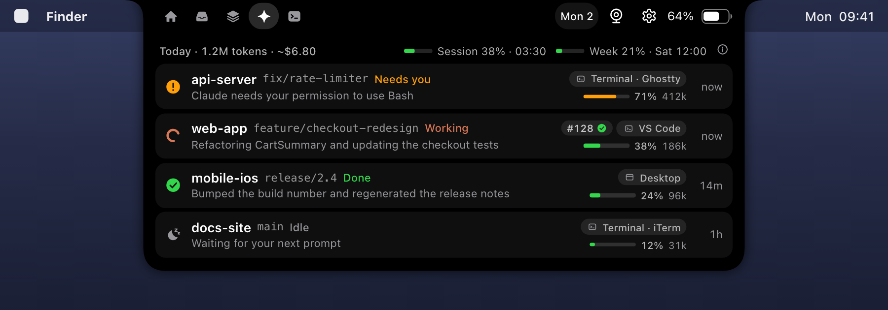
  <br>
  <sub>Images are rendered mockups with sample data. See <a href="docs/images/README.md">docs/images</a>.</sub>
</p>

## Install

```sh
brew tap murathanbakti/tap
brew trust --tap murathanbakti/tap
brew install --cask nubrix
open -a Nubrix
```

The first launch asks for no permissions. It shows which features will ask later and lets you pick a music source. Each permission is asked the first time you use the feature that needs it.

Without Homebrew, use the install script, which verifies the checksum and code signature before it installs:

```sh
curl -fsSL https://raw.githubusercontent.com/murathanbakti/nubrix/main/scripts/install.sh | bash
```

Or build from source (Xcode 26 or later):

```sh
git clone https://github.com/murathanbakti/nubrix.git
cd nubrix
scripts/install-local.sh --open
```

Releases from 0.1.1 on are signed with a Developer ID and notarized by Apple, so macOS opens them without a warning. Options, checks and signing your own build: [docs/nubrix/INSTALL.md](docs/nubrix/INSTALL.md).

## Claude Code setup

Nubrix learns about your sessions through Claude Code hooks. Setup is three steps. The installer never edits your Claude settings: you merge its snippet yourself.

**1. Install the hook scripts.**

```sh
bash /Applications/Nubrix.app/Contents/Resources/nubrix-hooks/scripts/install-hooks.sh
```

From a source checkout, run `scripts/install-hooks.sh` (`scripts/install-local.sh` already does). The installer verifies the app's signature and copies `nubrix-hook`, `nubrix-permission`, `nubrix-statusline` and `notchctl` to `~/.config/nubrix/bin/` as read-only files, outside any repository, so neither Claude nor a `git pull` can change what your hooks run ([why](docs/nubrix/CLAUDE-CODE.md#why-sealed-copies)). Run it again after every Nubrix update.

**2. Merge the printed snippet into `~/.claude/settings.json`.** The snippet has the exact paths for your machine. Shortened, it looks like this, with the same hook block for SessionStart, UserPromptSubmit, PreToolUse, PostToolUse, PostToolUseFailure, PermissionRequest, PermissionDenied, Notification, Stop, StopFailure and SessionEnd:

```json
{
  "hooks": {
    "SessionStart": [
      { "hooks": [ { "type": "command", "command": "~/.config/nubrix/bin/nubrix-hook", "async": true, "timeout": 5 } ] }
    ],
    "Stop": [
      { "hooks": [ { "type": "command", "command": "~/.config/nubrix/bin/nubrix-hook", "async": true, "timeout": 5 } ] }
    ]
  },
  "statusLine": { "type": "command", "command": "~/.config/nubrix/bin/nubrix-statusline" },
  "permissions": {
    "deny": [
      "Edit(~/.config/nubrix/**)", "Write(~/.config/nubrix/**)",
      "Edit(~/.config/nubrix-run/**)", "Write(~/.config/nubrix-run/**)",
      "Read(~/.config/nubrix-run/**)"
    ]
  }
}
```

- The `permissions.deny` rules keep Claude from editing the scripts or reading Nubrix's local token. They are added to your existing list.
- If you already use a status line, call `nubrix-statusline` from it, or pipe its input to both.
- The `PermissionRequest` block also holds the `nubrix-permission` hook for [notch approvals](#approve-permission-requests-from-the-notch). Leave it out to keep Claude Code's own permission dialogs only.

**3. Start a new Claude Code session.** It appears in the notch's Claude tab. The info button there says "All connected", or lists what is missing with a one-line fix.

The event hooks are asynchronous, time out quickly and always exit 0, so they never block Claude Code. If Nubrix is not running, they do nothing. To try it without touching your settings, load the status-only [plugin](docs/nubrix/CLAUDE-CODE.md#plugin-status-only-source-checkout) from a source checkout.

## Features

### Every Claude Code session at a glance

See which session is waiting for you without checking every tab.

- Each session shows as **Needs you**, **Working**, **Failed**, **Done** or **Idle**, with the most urgent first.
- Every row shows the project, git branch and where the session runs: the Claude desktop app, Terminal, iTerm, Ghostty, Warp, VS Code, Cursor, Zed and more.
- A context bar and token count show how full each session is.
- With GitHub connected, a chip shows your PR for the session's branch and its CI result. Click the chip to open the PR.
- Works with the Claude Code CLI, the Claude desktop app and the VS Code extension.

### Approve permission requests from the notch

When Claude Code asks to run a command or edit a file, the request appears in the notch with the full command, file or diff, and **Allow** and **Deny**.

- Allow needs a real mouse click after the card has been on screen briefly. Risky requests, such as `rm -rf`, `sudo`, force pushes or writes to sensitive files, need a second "Allow anyway" click.
- Nothing is approved automatically. If Nubrix is not running, the screen is locked or no answer arrives in time, Claude Code asks in its own dialog as before.
- The hook trusts only a reply that the running Nubrix signs with an HMAC over a fresh nonce.
- Claude's own questions and plan approvals stay in Claude.

<p align="center">
  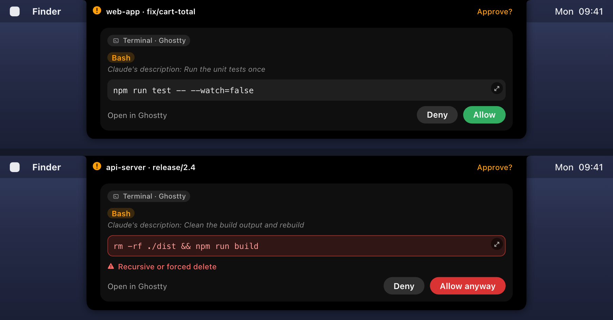
</p>

Rules, risk flags and wait times: [docs/nubrix/CLAUDE-CODE.md](docs/nubrix/CLAUDE-CODE.md#approving-permissions-from-the-notch).

### Jump straight to the session

Click a session row, or a Claude banner on the closed notch, and Nubrix opens that exact session.

- A Claude desktop app session opens in Claude.
- In Terminal or iTerm, the session's own tab comes to the front. macOS asks once whether Nubrix may control the app.
- Other terminals and editors are brought to the front.

[How it works](docs/nubrix/CLAUDE-CODE.md#opening-a-session).

### Plan usage and context

- Your 5-hour session and weekly plan usage as percentages, in the Claude tab and on a Home tab card next to the music player.
- The numbers come from `claude /usage`, a local command that uses no tokens. It needs a Claude subscription and a signed-in Claude CLI.
- Today's tokens and estimated cost, marked `~` because they come from list prices.
- Alerts when a session's context passes 85%, and when plan usage passes 80% and 95%.

<p align="center">
  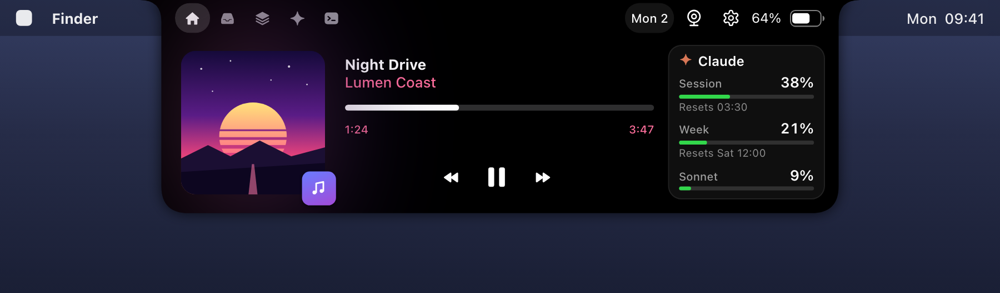
</p>

Sources, limits and what is stored: [docs/nubrix/CLAUDE-CODE.md](docs/nubrix/CLAUDE-CODE.md#usage-context-and-cost).

### Banners on the closed notch

A session that finishes, fails or needs you shows a short banner on the closed notch and lands in the inbox. Banners also appear for `notchctl` messages, GitHub events, new screenshots and upcoming meetings.

<p align="center">
  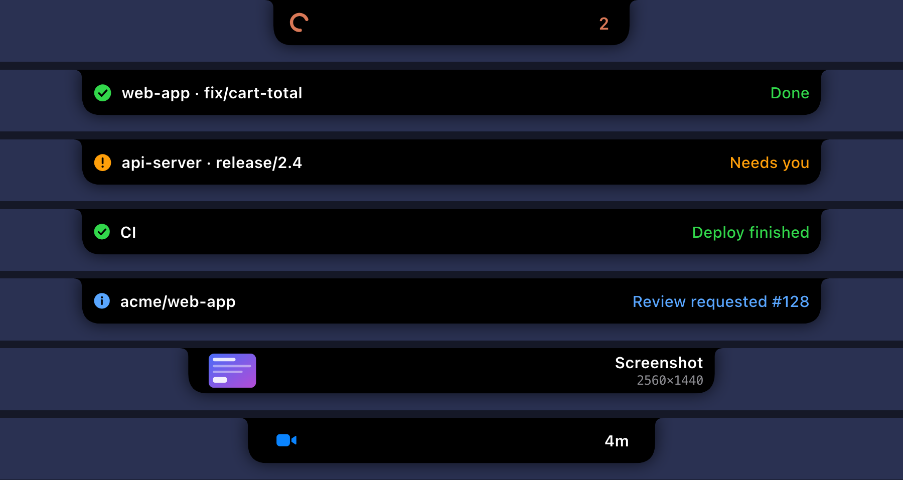
</p>

### Vitrin: clipboard and screenshot history

What you copy, and every new screenshot, stays within reach. Open it from its tab or with Control-Option-V.

- Images, text, links and screenshots appear as cards, with filters, search and keyboard navigation.
- Nubrix detects JSON, Base64, URL-encoded text, timestamps, colors, UUIDs and the language of code snippets. Each card gets one-click actions, such as copying pretty or minified JSON.
- Text that looks like a credential is never stored: private keys, `sk-` keys, GitHub, AWS and Slack tokens, JWTs, `Bearer` tokens and long random strings.
- Nothing is stored while a password manager or another app you exclude is in front.
- History expires after 30 days by default, and pinned items stay. The panel is hidden from screen sharing by default.

<p align="center">
  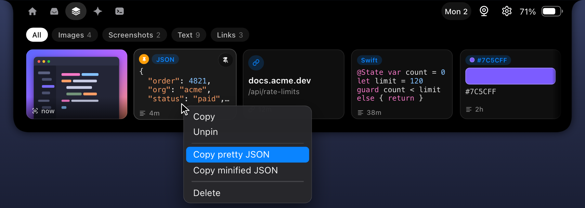
</p>

<details>
<summary>The Vitrin panel</summary>
<p align="center">
  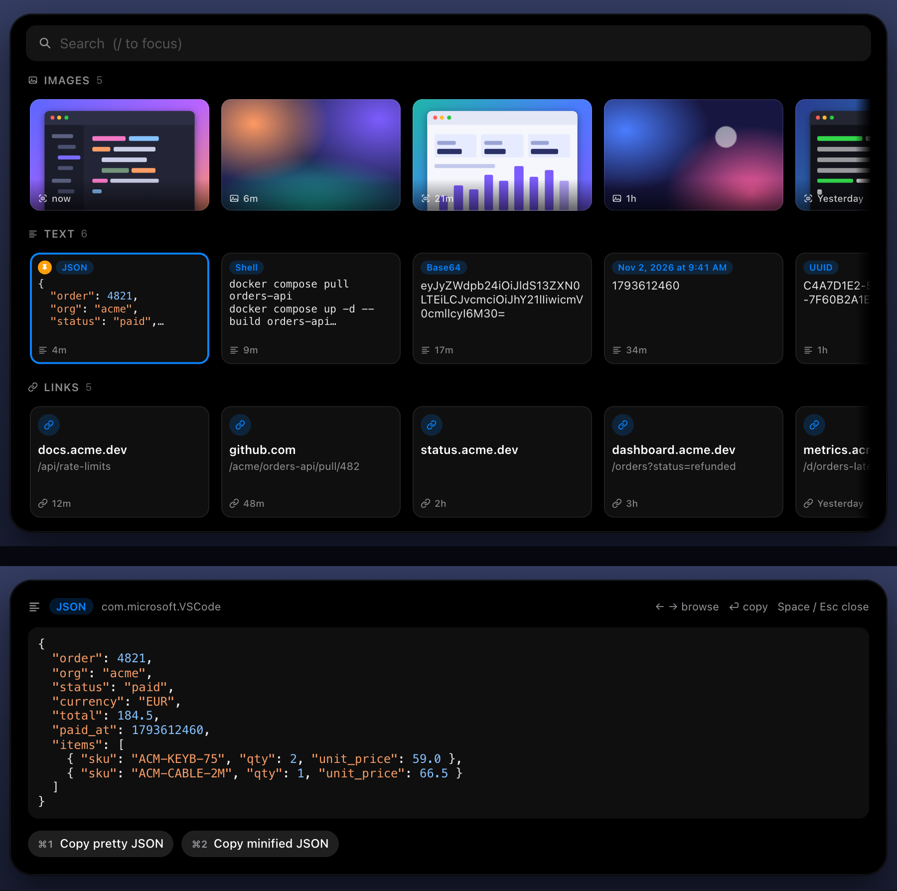
</p>
</details>

### Dev tab and notchctl

- `notchctl` puts a banner on the notch from any script: `gh run watch && notchctl notify "CI green"`. It needs only `bash` and `curl`.
- The Dev tab keeps your last notifications and shows which localhost ports are listening. Common dev ports are watched by default, and you can edit the list. Click an HTTP port to open it.

```sh
~/.config/nubrix/bin/notchctl notify "Build done" --title api --style success
~/.config/nubrix/bin/notchctl ping
```

<p align="center">
  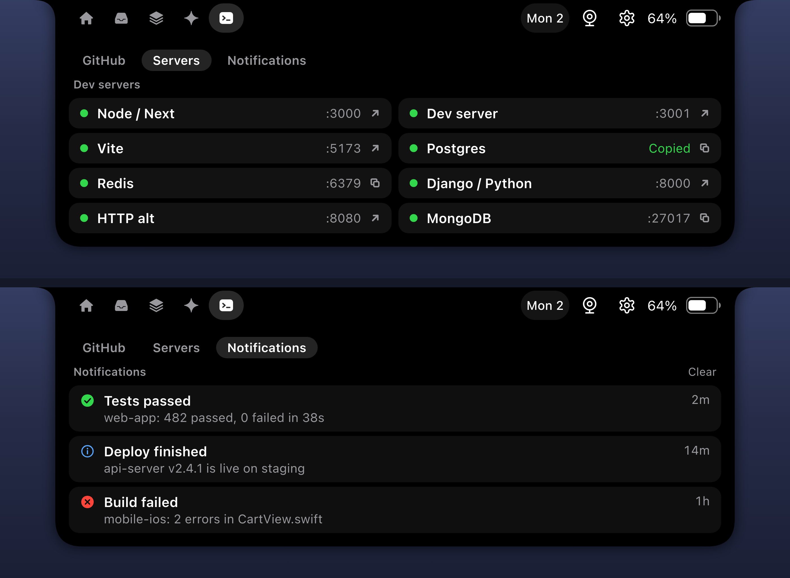
</p>

Styles, duration and adding it to your `PATH`: [cli/README.md](cli/README.md). `notchctl` needs the Dev tab to be on.

### GitHub integration

- The Dev tab's GitHub view shows three columns: PRs waiting for your review, your open PRs (CI, review decision, conflicts, draft) and recent Actions runs.
- Banners tell you when someone requests your review, your PR's CI turns red or green, a conflict appears, or a workflow fails on a default branch, on one of your PR or Claude session branches, or in a run you started.
- Nubrix only reads. It uses a fine-grained token you create for the repositories you choose (Settings, GitHub, "Create token on GitHub"), with read access to Metadata, Pull requests, Actions, Commit statuses and optionally Checks.
- The token lives in the macOS Keychain and goes only to `api.github.com`. Nubrix never uses your `gh` login or SSH keys, which can write.

<p align="center">
  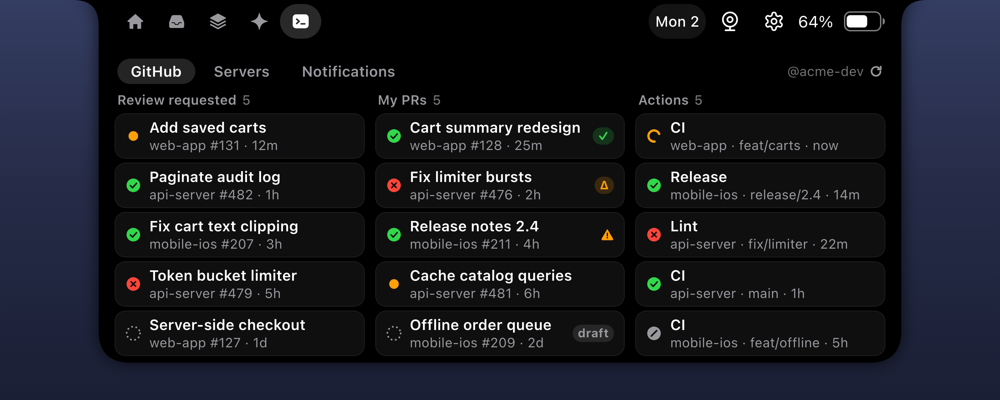
</p>

Requests, polling and why this kind of token: [docs/nubrix/GITHUB.md](docs/nubrix/GITHUB.md).

### Notifications from other apps

Optional and off by default. New notifications from the apps you pick, such as WhatsApp, Slack or Mail, appear as a banner on the closed notch. The Notifications tab keeps the last 50.

- Banners show the app icon, the chat or sender and the message, disappear after 6 seconds, and open the app when clicked. New messages from the same chat update the banner and its counter instead of opening a new one.
- The tab stacks notifications from the same chat into one card with the newest message and "+N more". Click "+N more" to see them all. A group or channel name, or a mail subject, gets its own small line and is never mixed into the message.
- Only the apps you tick are read, and the list lives in memory only. You can hide message text, and notifications from the app in front are skipped.
- It needs Full Disk Access, because macOS has no public way to read other apps' notifications. A short guide walks you through granting it.

<p align="center">
  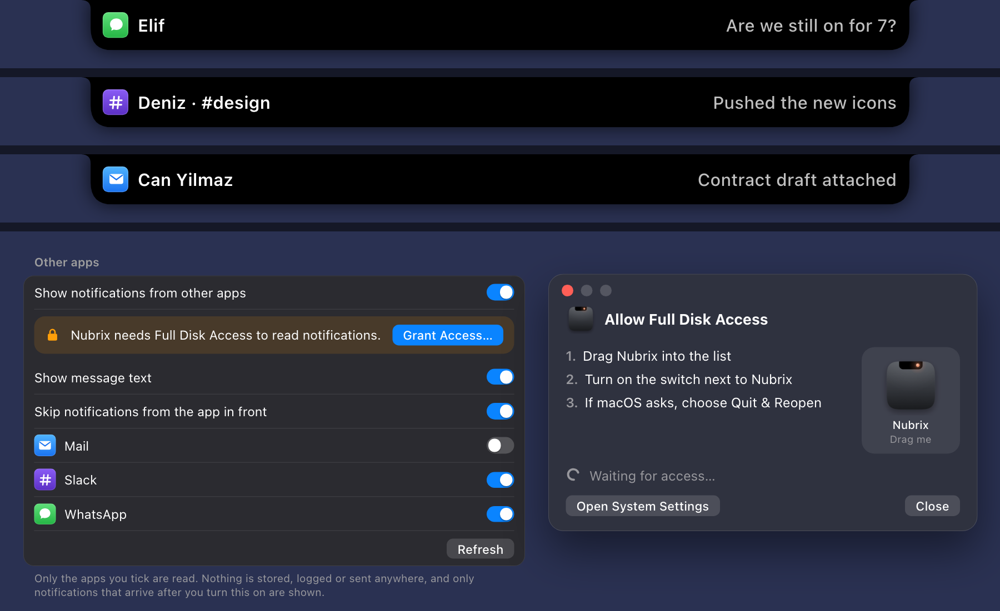
</p>

### Calendar, meetings and mirror

- A calendar sheet drops from the notch, from the date pill or Control-Option-K, with a day panel and quick add.
- A countdown to your next meeting appears on the closed notch. A Join button appears for Zoom, Google Meet, Teams, Webex, Whereby and Slack Huddle links.
- Mirror opens a camera preview from the notch (Control-Option-M).

<p align="center">
  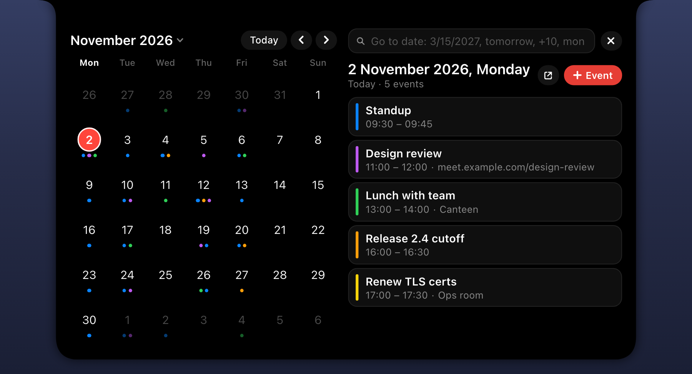
</p>

### Music, HUDs and shelf

The everyday notch features are here too:

- Now playing with controls and a visualizer, for system Now Playing, Apple Music, Spotify and YouTube Music. Synced lyrics are optional.
- Volume, display brightness and keyboard brightness HUDs in the notch (optional).
- A file shelf with drag and drop and AirDrop.

<p align="center">
  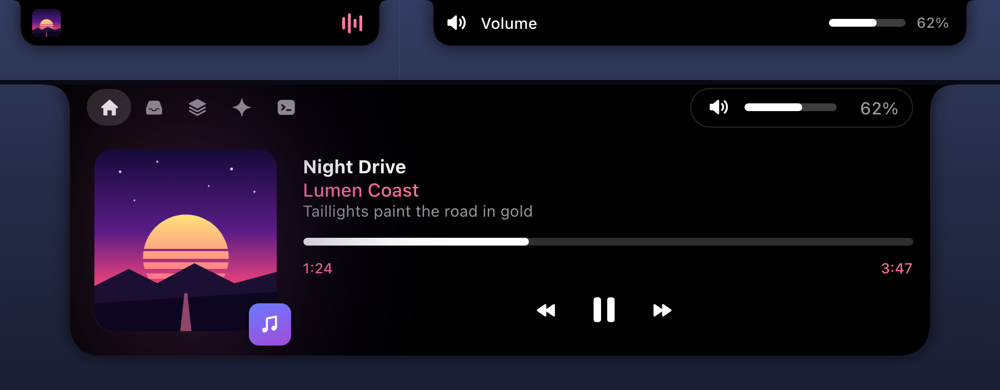
</p>

<details>
<summary>The shelf</summary>
<p align="center">
  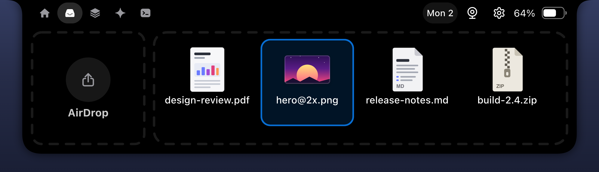
</p>
</details>

### Make it yours

- Every feature that needs a permission or controls another app has its own switch in Settings. When a switch is off, Nubrix asks for nothing and runs nothing for that feature. Turning it back on takes effect at once, with no restart.
- In Settings, Tabs, drag the notch tabs into any order and hide the ones you don't use.

<p align="center">
  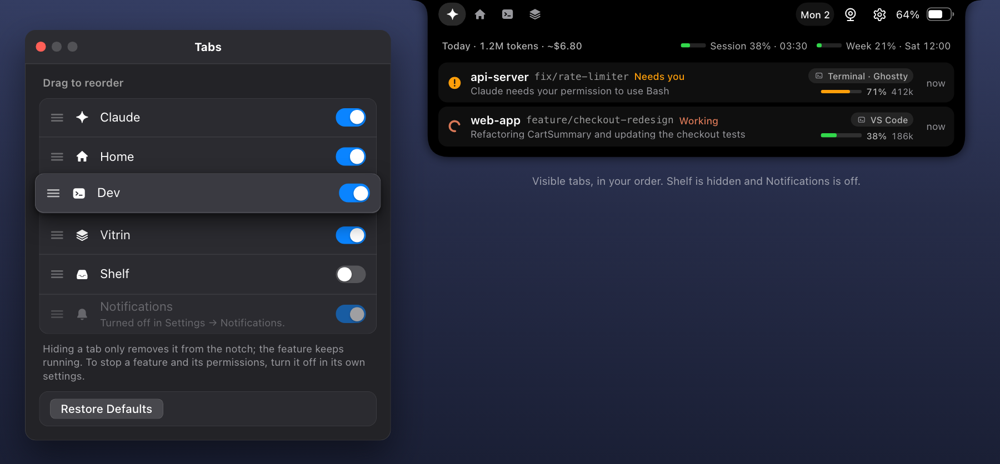
</p>

Every switch and where it lives: [docs/nubrix/PERMISSIONS-AND-SETTINGS.md](docs/nubrix/PERMISSIONS-AND-SETTINGS.md#settings).

## Privacy and security

- **Local only.** No account, no analytics, no Nubrix server and no auto-updater (an optional daily check only asks GitHub for the latest version number; it is off until you turn it on). The network is used only for GitHub (with your token), the release check above, lyrics (off by default), cover art, and a visualizer animation if you turn off the built-in one. Plan usage is read by running your own `claude` CLI. [Complete list](docs/nubrix/PRIVACY-AND-SECURITY.md#network-use).
- **Sandboxed.** The app runs in the macOS sandbox. The only unsandboxed part is the small helper `NubrixHelper`, which handles keys and brightness, reads plan usage and, when you turn it on, opens the notification database read-only.
- **Sealed hooks.** The scripts Claude Code runs are read-only copies the app itself cannot change. They talk to Nubrix over loopback only, with a random port and token, and they verify Nubrix with an HMAC challenge before trusting an answer.
- **Signed releases.** Releases are built by GitHub Actions and, from 0.1.1 on, signed with a Developer ID and notarized by Apple. The signing key is kept away from the build.

Details: [docs/nubrix/PRIVACY-AND-SECURITY.md](docs/nubrix/PRIVACY-AND-SECURITY.md). To report a vulnerability, see [SECURITY.md](SECURITY.md).

## Permissions

Nubrix asks for a permission only the first time you use a feature that needs it, with a short explanation first. The first launch asks for none:

- Calendars for the calendar and meetings
- Camera for Mirror
- Accessibility for the custom HUDs
- Automation for Spotify, Apple Music, and opening Terminal or iTerm sessions
- Your screenshot folder (read-only) for Vitrin
- Full Disk Access for notifications from other apps

There is no Screen Recording permission. Turning a switch off stops the feature. To take back a permission, use System Settings, Privacy & Security. [Full table](docs/nubrix/PERMISSIONS-AND-SETTINGS.md#permissions).

## Requirements

- macOS 14 Sonoma or later, Apple silicon or Intel
- Xcode 26 or later to build from source

On a Mac without a notch, Nubrix draws the bar at the top of the display. Set its height in Settings, General.

## First launch and Gatekeeper

Releases from 0.1.1 on are notarized and open normally. This section is only for a zip of 0.1.0, or another release that is not notarized, downloaded with a browser:

1. Open Nubrix (Spotlight or `/Applications`). macOS says "Nubrix" was blocked or cannot be verified. Click **Done** (**Cancel** on macOS 14 Sonoma). Do **not** click **Move to Trash**: that deletes the app.
2. Open Privacy & Security:
   ```sh
   open "x-apple.systempreferences:com.apple.settings.PrivacySecurity.extension"
   ```
   or go to System Settings, Privacy & Security, and scroll down to "Nubrix was blocked to protect your Mac".
3. Click "Open Anyway" and confirm with your admin password or Touch ID. Open Nubrix again and confirm.

You do this once per download. On macOS 14 Sonoma you can instead right-click Nubrix in Finder, choose Open and confirm; on macOS 15 Sequoia and later only Privacy & Security works. Do not turn Gatekeeper off (`spctl --master-disable`): it protects every other app on your Mac.

If you verified the download's origin and checksum yourself, `xattr -d com.apple.quarantine /Applications/Nubrix.app` removes the quarantine flag for that one app.

## Updating

Nubrix never downloads or installs updates itself. In Settings, About, Updates you can turn on a daily check (or press Check now): it asks GitHub for the latest release number, and if a newer one exists it shows the command for your install type. Update with the method you installed with:

```sh
brew upgrade --cask nubrix
```

or run the install script again, or `git pull && scripts/install-local.sh` for a source install. Then re-run `install-hooks.sh` so the sealed copies match the new version, and open Nubrix again. Only a release that is not notarized (0.1.0), downloaded with a browser, needs the [First launch](#first-launch-and-gatekeeper) step.

## Uninstall

1. First remove the Nubrix entries from `~/.claude/settings.json`: the hooks, `statusLine` and the `permissions.deny` rules for `~/.config/nubrix*`. Otherwise Claude Code keeps trying to run scripts that no longer exist.
2. Quit Nubrix and remove it:
   ```sh
   brew uninstall --cask nubrix
   ```
   `brew uninstall --cask --zap nubrix` also removes `~/.config/nubrix`, `~/.config/nubrix-run`, the app container and preferences. Without Homebrew, delete `/Applications/Nubrix.app` and those same folders by hand.
3. Optional: delete the Keychain item `dev.nubrix.github` (Keychain Access), revoke the GitHub token on github.com, and remove Nubrix from System Settings, Privacy & Security, Full Disk Access if you had granted it.

## Troubleshooting

The most common fixes:

- [macOS says Nubrix cannot be opened](docs/nubrix/TROUBLESHOOTING.md#macos-says-nubrix-cannot-be-opened)
- [No Claude sessions show up](docs/nubrix/TROUBLESHOOTING.md#no-claude-sessions-show-up)
- [Approvals do not appear in the notch](docs/nubrix/TROUBLESHOOTING.md#approvals-do-not-appear-in-the-notch)
- [Claude sign-in needed](docs/nubrix/TROUBLESHOOTING.md#claude-sign-in-needed)
- [Keychain or permission prompts after an update](docs/nubrix/TROUBLESHOOTING.md#keychain-or-permission-prompts-after-an-update)

Everything else, including Vitrin, music, HUDs and notifications from other apps: [docs/nubrix/TROUBLESHOOTING.md](docs/nubrix/TROUBLESHOOTING.md).

## Documentation

| Page | What is in it |
|---|---|
| [Installing Nubrix](docs/nubrix/INSTALL.md) | Every install method, its checks and options, signing your own build |
| [Claude Code integration](docs/nubrix/CLAUDE-CODE.md) | Sealed hooks, opening sessions, usage numbers, notch approvals |
| [GitHub integration](docs/nubrix/GITHUB.md) | Token, requests and polling |
| [notchctl](cli/README.md) | The command-line tool |
| [Permissions and settings](docs/nubrix/PERMISSIONS-AND-SETTINGS.md) | Every permission and every Settings tab |
| [Privacy and security](docs/nubrix/PRIVACY-AND-SECURITY.md) | Network use, sandbox, local endpoint, storage, signing |
| [Troubleshooting](docs/nubrix/TROUBLESHOOTING.md) | Common problems and fixes |
| [Roadmap](docs/nubrix/ROADMAP.md) | What is planned |

## Building and contributing

```sh
xcodebuild -project Nubrix.xcodeproj -scheme Nubrix -configuration Debug \
  -derivedDataPath build -destination 'platform=macOS' build
open build/Build/Products/Debug/Nubrix.app
```

See [CONTRIBUTING.md](CONTRIBUTING.md) for the development workflow, security-sensitive areas and how releases are cut.

## License

GNU General Public License v3.0, see [LICENSE](LICENSE). [NOTICE](NOTICE) states that Nubrix is a modified version of boring.notch, which commit it was forked from and who modified it. `LICENSE`, `NOTICE` and `THIRD_PARTY_LICENSES` are also bundled in the app's Resources.

## Credits

- [boring.notch](https://github.com/TheBoredTeam/boring.notch) by TheBoredTeam and its contributors, the project Nubrix is forked from (GPL-3.0)
- Ideas and selected logic for Vitrin from ClipBoardLine (MIT) and Tendedero (MIT)
- [mediaremote-adapter](https://github.com/ungive/mediaremote-adapter) (BSD-3-Clause)
- Every other bundled or linked dependency, with its copyright line and license, is listed in [THIRD_PARTY_LICENSES](THIRD_PARTY_LICENSES)

## Disclaimer

Nubrix is an independent project. It is not affiliated with, endorsed by or sponsored by Anthropic. Claude and Claude Code are trademarks of Anthropic.
